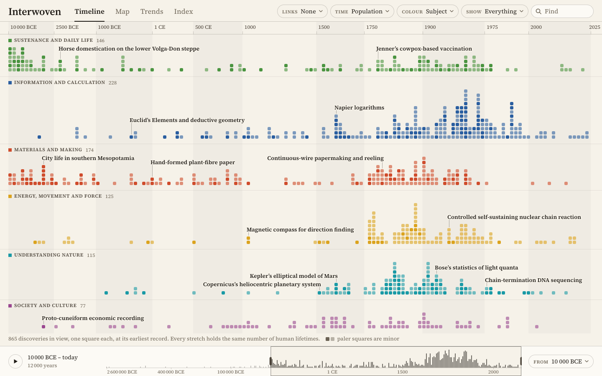
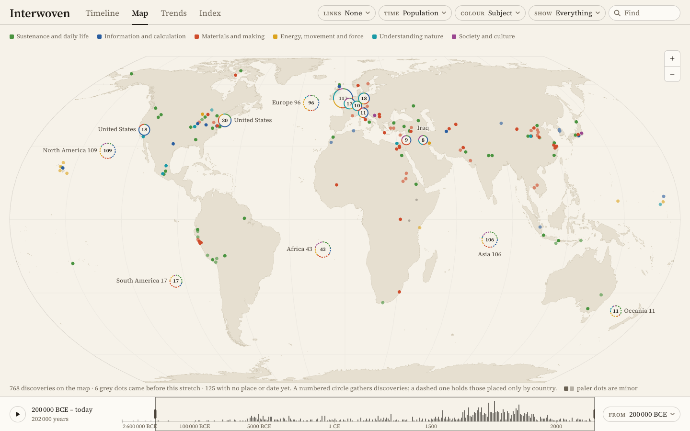
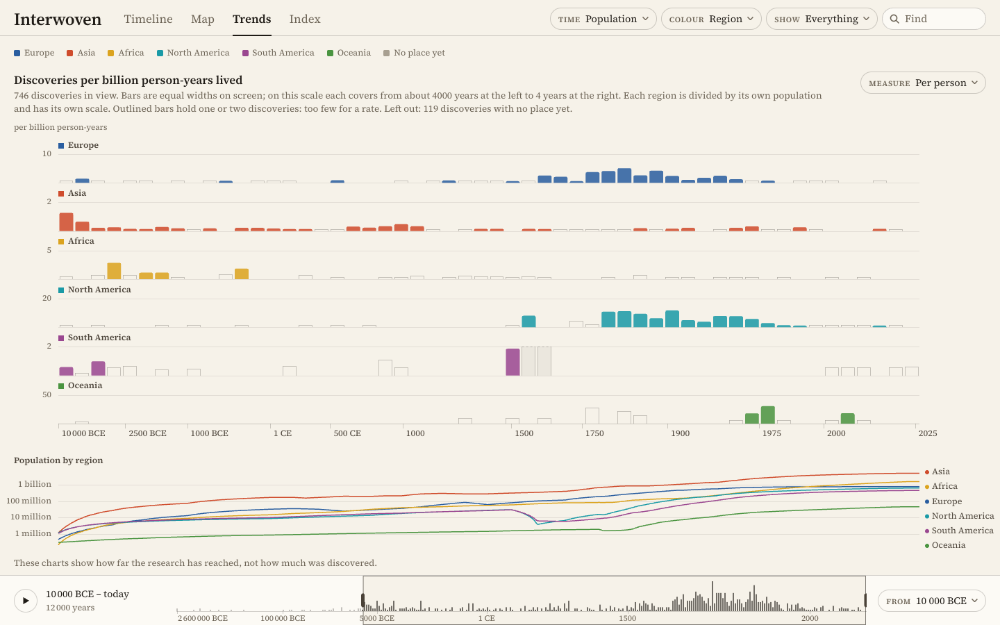

# Interwoven

A map and timeline of what people have discovered and invented, and how each thing connects to the others. The aim is a tech tree of human civilisation: every discovery recorded with as much structured information as the evidence supports, so that connections of many kinds can be researched and drawn.

It is a selective, growing record. It shows how far the research has reached, not everything that happened.



| | |
| --- | --- |
|  |  |

| Folder | What it holds |
| --- | --- |
| `data/` | The dataset: one file per discovery and per source, registers of places, people, organisations and societies, and the vocabularies and schema that define them |
| `evidence/` | Saved copies of the sources |
| `tools/` | Python tools that validate the dataset, report what is researched, fetch evidence and compile the data for the app |
| `app/` | The app: timeline, map, trends and index views over the dataset |
| `docs/` | The data model, the research guide and the app's design |

## Run it

```bash
npm install
npm run dev
```

Then open http://localhost:5175. The app rebuilds its data whenever a file in `data/` changes. It needs Node 22 or later and Python 3.11 or later, and no Python packages.

## Work on the data

```bash
python3 tools/validate.py                    # check everything
python3 tools/coverage.py                    # how much of each facet is researched
python3 tools/coverage.py --missing funding  # the records still lacking one facet
python3 tools/coverage.py --grid             # gaps by domain, region and era
npm test                                     # tests for the tools and the app
```

Read `docs/data-model.md` for what a record holds, `docs/research-guide.md` for how to add to it, and `docs/importance.md` for how importance is judged and what to add next. `docs/research-agents/` has the briefs and tools for researching in batches with agents: `data/leads.jsonl` holds the capabilities still to research, each with the place that reached it and why it matters. `AGENTS.md` has the working rules for this repository.

## Evidence

Text evidence is committed. PDFs and images are not: each has a small `.cache.json` descriptor beside it with its checksum and where to fetch it, so the dataset validates on a machine that has none of them.

```bash
python3 tools/evidence.py status            # what is present on this machine
python3 tools/evidence.py fetch <source-id> # download one file, checked against its checksum
```

Binary evidence was once committed, so a fresh clone is much smaller with `git clone --filter=blob:none`.

## Where the numbers come from

World and regional population comes from Our World in Data (HYDE 3.3, Gapminder and the UN, CC BY 4.0) back to 10,000 BCE, and from Kremer (1993) before that. `data/reference/population.json` lists the sources and the method.

Many facets were first entered from general knowledge and are marked `recalled` until someone checks them against a source. That includes every coordinate in the gazetteer. The app marks these values, and `python3 tools/coverage.py --basis recalled` lists them.

## Loading and research queries

The app preloads a compact, versioned overview and fetches full records and view code on demand.
Agents keep editing the JSON files; `python3 tools/research.py search 'steam engine'` searches a
generated SQLite index and returns source-file paths. The index refreshes when source files change.
See [performance and caching](docs/performance.md) for graph queries, deployment headers, measured
loading budgets and reproducible browser/research benchmarks.
