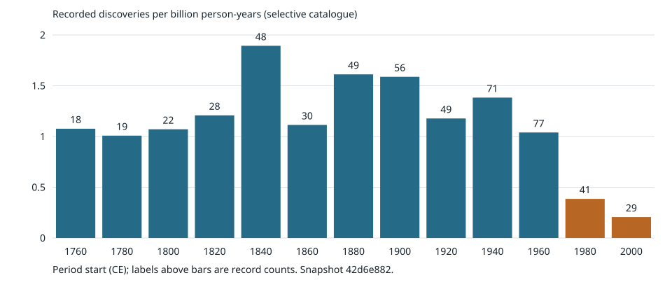

# The post-1970s discovery-rate decline

The decline is a reproducible feature of this catalogue. Independent research also supports slower productivity growth and declining returns to research effort in several settings. The catalogue cannot establish the size of a worldwide discovery slowdown, its precise start, or whether the social changes of the 1970s caused it. Its coverage is too selective and uneven for those claims.

## What the catalogue shows

This audit freezes the committed dataset at `42d6e8829d1ed4d320468613137771cd67c2818f`: 886 records, of which 882 have a chartable anchor. It excludes the unfinished changes present in the shared working directory. The comparison snapshot is `9cc69490e82a2a5932a028061006734f5ba94626`, the last ancestor of that commit committed before midnight UTC on 9 November: 673 records, 669 chartable. This reconstructs committed data, not the user's exact screen, filters, or uncommitted collection yesterday.

One observation is one discovery **record**, including local achievements, improvements and instances. It is not necessarily a unique world-first. As in the app, the anchor is the latest bound of the event identified by `earliest_record`. The denominator is the integral of world population over the period, expressed in billions of person-years. It is not the number of scientists or inventors.

| Complete period | Records in 10 November snapshot | Billion person-years | Records per billion person-years |
| --- | ---: | ---: | ---: |
| 1950–1959 | 50 | 27.460 | 1.821 |
| 1960–1969 | 36 | 33.376 | 1.079 |
| 1970–1979 | 41 | 40.695 | 1.007 |
| 1980–1989 | 19 | 48.761 | 0.390 |
| 1990–1999 | 22 | 57.562 | 0.382 |
| 2000–2009 | 14 | 65.905 | 0.212 |
| 2010–2019 | 15 | 74.655 | 0.201 |

The main equal-duration comparison is 1960–1979 against 1980–1999. Counts fall from 77 to 41, or 46.8%. Population exposure rises from 74.072 to 106.323 billion person-years, or 43.5%. The rate falls from 1.040 to 0.386, or **62.9%**. Thus population growth amplifies a fall that is already present in the numerator.

In the 9 November snapshot the corresponding counts are 63 and 34, and rates 0.851 and 0.320: a **62.4%** fall. The later catalogue expansion does not remove the pattern, but the two snapshots share much of their selection process and are not independent replications.

Before 1980, the twenty-year rates from 1760 onwards mostly occupy a band around 1–2 records per billion person-years; they are not literally constant. The substantial 1950s peak and sparse counts matter. A smooth earlier shape does not establish that later coverage is comparable.



## Robustness and its limits

For the same 1960–1979 versus 1980–1999 comparison:

| Records counted | Earlier count | Later count | Rate decrease |
| --- | ---: | ---: | ---: |
| All dated records | 77 | 41 | 62.9% |
| Capabilities only | 45 | 17 | 73.7% |
| Scored tiers 0–1 | 53 | 31 | 59.3% |
| Electronics and computing | 31 | 20 | 55.1% |
| Other domains | 46 | 21 | 68.2% |
| Known dates only | 59 | 31 | 63.4% |
| Dates with both bounds, latest-bound placement | 62 | 34 | 61.8% |
| Same bounded records, earliest-bound placement | 61 | 34 | 61.2% |

All 118 records in the main comparison have events marked sourced or reviewed. That concerns the recorded events' evidence; it does not establish completeness of the collection or that the anchor is an invention date. Some anchors date documentation or practical use.

Moving the split to 1970, 1975, 1985 or 1990, with twenty years on either side, still produces a lower later rate. Ten-year bins locate the most visible step around 1980 rather than an immediate 1970 discontinuity. A descriptive two-constant-rate fit, searching 1945–1990 with at least ten years on either side, selects 1981 for windows starting in 1800, 1900 and 1940 and ending in 2000. Requiring twenty years on either side selects 1980 at the search boundary. These are descriptions of selected records, not precise estimates of a historical turning point. They cannot determine a five- or ten-year causal lag from a chosen social change.

Geographic adjustment alone does not remove the decline. Using each region's own population, the recorded rates decrease in North America, Europe and Asia. But location is missing for 15/77 earlier records and 15/41 later records, and the app assigns multinational work to a single most precise place. North America is not synonymous with the US; these regional cuts do not support a causal country comparison.

## Why this cannot yet measure the true discovery rate

The most consequential problem is directly visible: **there are zero physical-science, mathematics, or materials records anchored in 1980–1999** in the frozen dataset. In contrast, it contains many nineteenth-century and early twentieth-century records in these fields. There are also no mathematics records anchored in 1960–1979. This is a coverage diagnostic, not evidence that those fields stopped progressing.

Specific missing mature achievements include the [1985 discovery of fullerenes](https://www.nobelprize.org/prizes/themes/the-nobel-prize-in-chemistry-the-development-of-modern-chemistry/), [1986 high-temperature superconductivity](https://www.nobelprize.org/prizes/physics/1987/muller/facts/), and [1995 detection of a planet orbiting a Sun-like star](https://www.nobelprize.org/uploads/2019/10/mayor-lecture.pdf). Searches of the frozen record names and inspection of the relevant domains found no corresponding records. These examples establish omissions; they do not quantify the missing fraction, and adding only famous counterexamples would introduce another selection bias.

The catalogue also mixes capabilities, improvements and instances. Counting capabilities alone preserves the fall, so this simple grain adjustment is insufficient, but it cannot repair entirely missing capabilities. Origin is absent for 64/77 earlier and 39/41 later records; none of those 118 is classified `first_known`. A credible frontier-only series cannot be obtained by filtering this subset today.

Importance is based partly on consequences observed so far. Recent discoveries have less time to accumulate descendants and reach, so major-only filtering introduces unequal follow-up. Omitting 2020 onwards avoids incomplete recent periods and the shortest recognition lag, but it does not correct selection in earlier decades.

Conceptually, recorded output equals actual eligible output multiplied by the fraction collected, with additional effects from how achievements are split into records. Dividing by population leaves that unknown collection fraction in the result. Earlier stability cannot identify it. No selection probabilities or independent coverage denominator are available here, so ordinary Poisson confidence intervals would understate the relevant uncertainty. No population-level significance test or causal regression is reported.

## What independent evidence establishes

**Economic productivity has a well-documented 1970s break.** The [BLS historical nonfarm-business series](https://www.bls.gov/productivity/charts/long-term-labor-productivity-by-sector-for-selected-periods.htm), updated 5 November 2026, reports annual labour-productivity growth of 2.7% in 1947 Q1–1973 Q4, 1.4% in 1973 Q4–1980 Q1, and 1.6% in 1980 Q1–1990 Q3. Later periods include renewed faster growth. This supports a real economic slowdown, but output per hour also reflects capital, organisation and diffusion; it is not a discovery count.

**Research effort and technical progress can diverge.** [Bloom, Jones, Van Reenen and Webb (2020)](https://web.stanford.edu/~chadj/IdeaPF.pdf) find declining research productivity across semiconductor, agriculture, medical and firm-level examples. Their estimated effective research effort required to sustain chip-density doubling rises more than eighteenfold from the early 1970s to their modern endpoint. Inputs are estimated from spending and related measures, not a literal count of equally productive individual researchers. Their aggregate analysis begins in the 1930s, so the study does not identify a universal sudden 1973 break. Sustained technical progress can coexist with falling output per unit of research effort.

**Disruption metrics need special caution.** [Park, Leahey and Funk (2023)](https://www.nature.com/articles/s41586-022-05543-x) report falling average citation-network disruption across large paper and patent collections. Average disruption is not the absolute number of breakthroughs. [Macher, Rutzer and Weder](https://arxiv.org/abs/2306.10774), published in Research Policy in 2024 with a revised author version in 2026, attribute 88% of the reported patent-index decrease over 1980–2010 to truncated backward citations and also adjust for citation-rule changes. A [2026 Nature Matters Arising](https://www.nature.com/articles/s41586-026-10787-y) identifies additional dataset artefacts, with an [authors' reply](https://www.nature.com/articles/s41586-026-10788-x). Those last two sources were inspected through indexed publisher summaries; full text was unavailable. They establish an active measurement dispute, not a complete resolution. The original result is not an independent, uncontested confirmation of this catalogue's apparent decline.

## How the social hypothesis fares

Some timing overlaps are supported. [Piketty and Saez](https://www.nber.org/papers/w8467) document the recovery of US top wage shares from the 1960s–1970s onwards. [ONS marriage statistics](https://www.ons.gov.uk/peoplepopulationandcommunity/birthsdeathsandmarriages/marriagecohabitationandcivilpartnerships/bulletins/marriagesinenglandandwalesprovisional/2017) show declining first-marriage numbers from 1972. Those observations make the period worth studying, but they do not identify a common cause or establish an effect on discovery.

The trends do not share one universal turning point. [ONS divorce statistics](https://www.ons.gov.uk/peoplepopulationandcommunity/birthsdeathsandmarriages/divorce/bulletins/divorcesinenglandandwales/2017/pdf) place the England-and-Wales divorce-rate peak in 1993, with substantially lower rates by 2017. Annual divorce counts and rates are not marriage-cohort survival probabilities. [Knoll, Schularick and Steger's long-run housing study](https://fraser.stlouisfed.org/files/docs/historical/frbdal/workingpapers/frbdal_gwp_208.pdf) places the broad house-price transition across fourteen advanced economies in the middle of the twentieth century, with country differences. Real house prices, price-to-income ratios and the share of household income spent on housing are distinct measures. The housing evidence is compatible with a longer structural shift; it does not establish one common 1970 date.

There are plausible, better-evidenced channels to investigate. [Bell and colleagues](https://www.nber.org/papers/w24062) link inventive careers to childhood opportunity and exposure, including a tenfold difference between children from top-1%-income and below-median-income families. Their childhood-exposure analysis supports a role for environment, rather than treating the income gap itself as a causal effect of inequality. [Azoulay, Graff Zivin and Manso](https://faculty.haas.berkeley.edu/manso/papers/incentives-and-creativity.html) find more high-impact research under funding with longer horizons and greater tolerance for early failure than in a matched comparison group. These findings support specific opportunity and incentive mechanisms. Neither demonstrates that rising inequality, housing costs or changes in marriage caused a worldwide post-1970 discovery slowdown.

A burden of accumulated knowledge, growing specialisation and longer training are competing explanations, developed by [Benjamin Jones](https://www.nber.org/papers/w11360). Technological change can itself alter income distribution and housing demand, so reverse causation is also plausible. Merely correlating several trending aggregate series, or selecting a lag after seeing their shapes, cannot distinguish these mechanisms.

## A discriminating next study

First define an outcome independent of this observed dip: for example, a fixed set of scientific fields and a prespecified rule for counting documented capabilities from 1940–2000. Audit every decade with equal source-search effort, retain rejected candidates and missingness, and compare against external field chronologies selected before examining their trends. Do not target a desired flat curve or a desired decline.

Then separate three questions: output per inhabitant, output per researcher-year, and downstream economic productivity. Obtain researcher full-time-equivalent and research-spending series by country and field. Measure impact over equal follow-up windows instead of allowing older discoveries more time to prove important.

Only then compare countries or institutions with different timing and intensity of housing pressures, inequality or funding changes. Prespecify outcomes, lags and comparison groups; examine pre-trends and policy-driven variation where defensible. For family formation, use marriage-cohort outcomes and cohort exposure rather than the ratio of divorces to weddings in a calendar year. Childhood-opportunity channels imply generational lags; a five-year lag from a 1973 change would be a different mechanism from changed funding or researcher living costs.

The evidence presently supports investigating a real productivity problem and specific institutional mechanisms. It does not support choosing a broad social explanation from the shared timing alone.

## Reproduction and verification

```sh
python3 tools/discovery_trend_audit.py \
  --revision 42d6e8829d1ed4d320468613137771cd67c2818f \
  --compare-revision 9cc69490e82a2a5932a028061006734f5ba94626 \
  --output docs/analysis/2026-11-10-discovery-rate
```

The tool uses only the Python standard library. It reads immutable Git archives, records the source commit, hashes the discovery records, population and place inputs, and records its own SHA-256. `records.csv` contains the dated records and individual record hashes. `results.json` contains the bins, comparison windows, filters, geography, completeness profiles and descriptive fits. The static SVG is drawn in Python. `interactive.html` presents the already calculated results without performing a simulation or independent analysis in the browser.

`verification.json` records analytical closed-form checks, count reconciliation, the rate-ratio decomposition and comparison to the app's population integration. For these twenty-year windows, maximum relative exposure difference from the app calculation is below 1.6 × 10⁻¹⁴. Chart configurations, rendering, interactions and the repository test result are recorded in the companion validation record. No discovery data were changed by this audit.
