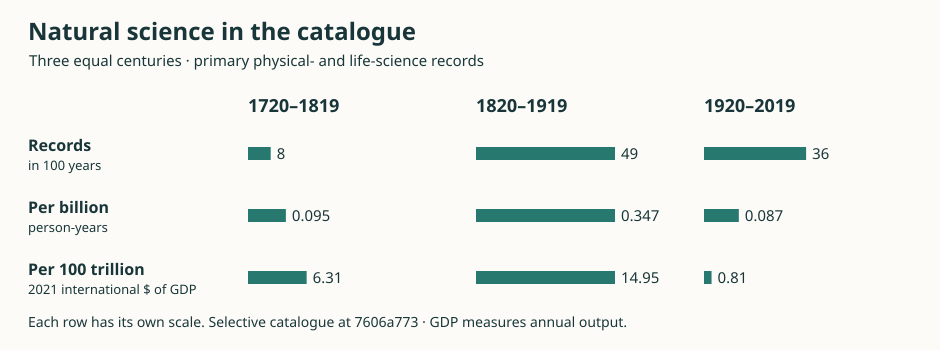

# Scientific achievements, population and world wealth

On 17 November 2026, the catalogue contained a concentration of natural-science achievements in **1820–1919**. The preceding century has 8 records, that century has 49, and the following century has 36. Between the middle and last centuries the count falls 27%, the rate per person falls 75%, and the rate per unit of real GDP falls 95%. The signal survives a search over many dates and windows. Changing which disciplines count as science reverses even the direction of the raw decline. The reach of the catalogue sets the limit on any inference about humanity.



## What the project can measure

The analysis freezes [catalogue revision 7606a773](https://github.com/sprajs/interwoven/tree/7606a77353078d8ba7d23ff974c7426528b417c6/data). Of 987 achievement records, 983 have a dated anchor. The primary measure counts the 119 dated records whose primary field lies in the taxonomy’s “Understanding nature” group, comprising 81 physical-science and 38 life-science records. An achievement has unit weight, irrespective of its impact. A publication, an observation, a local achievement and an attested description can each supply an anchor. Only nine of these records predate 1500 CE, five of them BCE. That is too little evidence to date ancient or medieval worldwide takeoffs or collapses. Three records dated 2020 or later sit beyond the historical scan.

| Complete century | Physical sciences | Life sciences | Population exposure, billion person-years | Real GDP produced, trillion 2021 int. $ | Records per billion person-years | Records per 100 trillion int. $ |
| --- | ---: | ---: | ---: | ---: | ---: | ---: |
| 1720–1819 | 5 | 3 | 84.54 | 126.82 | 0.095 | 6.31 |
| 1820–1919 | 40 | 9 | 141.10 | 327.72 | 0.347 | 14.95 |
| 1920–2019 | 16 | 20 | 413.89 | 4,437.03 | 0.087 | 0.81 |

**Fields move differently.** Physical sciences fall from 40 to 16 while life sciences rise from 9 to 20. Adding mathematics, measurement and health changes 49 → 36 to **82 → 90**, although the broader rate per person still falls 63%. Relative to all discoveries collected, the narrow science group accounts for 49/215 (23%) in 1820–1919 and 36/326 (11%) in 1920–2019. The project has no physical-science anchors in 1980–1999, a period that includes the 1995 report of a planet orbiting 51 Pegasi. This gap demonstrates how a change in which achievements get recorded can resemble a historical slowdown. [Mayor and Queloz, 1995](https://www.nature.com/articles/Art1)

## Which turning points survive the search?

The search compares 20-, 50-, 100- and 200-year windows on a ten-year grid within 1000–2019 CE. Each candidate asks either whether two adjacent rates differ or whether the middle of three windows departs from a constant proportional trend. Here a “bend” means a change in trend across the chosen windows. Its date resolution is the width of those windows. The tests cannot identify a unique year or distinguish an abrupt event from a gradual transition inside a window.

| Question | Strongest relevant comparison | Result after correcting for the full search |
| --- | --- | --- |
| When does the number recorded rise? | 14 in 1620–1819, then 85 in 1820–2019 | 6.07 times as many, adjusted p = 2.7 × 10⁻¹⁰. The best upward per-person comparison has adjusted p = 0.33. |
| Is there a sustained bend? | 8 → 49 → 36 in three centuries starting in 1720 | Downward bend on calendar time (adjusted p = 0.027), per person (4.4 × 10⁻⁵) and per unit of GDP (4.9 × 10⁻¹²). |
| When does the normalized rate drop? | 1820–1919 versus 1920–2019 | Later/earlier rate ratio 0.250 per person (simultaneous 95% interval 0.094–0.641, adjusted p = 1.2 × 10⁻⁶). Per GDP, the ratio is 0.054 (0.020–0.139, adjusted p = 4.2 × 10⁻³¹). |
| Is the later decline visible on shorter windows? | 1910–1959 versus 1960–2009 | 26 versus 14 records, 0.234 versus 0.057 per billion person-years, adjusted p = 0.040. No 20-year-window comparison passes the 5% family threshold on any scale. |

Many overlapping splits describe the same change. For example, 100-year calendar-count comparisons signal a rise at decade boundaries from 1770 through 1830. The 100-year per-person comparisons signal declines at both 1910 and 1920. There is no comparable corrected evidence for any outright fall in the **unadjusted** two-window record count. The three-window bend asks a different question and captures the change from rapid increase to a flatter or falling trajectory.

**The specific 1980 hypothesis is weak for natural science.** The [earlier whole-catalogue audit](../2026-11-10-discovery-rate/report.md) motivated a fixed comparison of 1960–1979 against 1980–1999. The natural-science counts are 8 versus 3, and person-adjusted rates are 0.108 versus 0.028 per billion person-years. The ratio is 0.26 with an ordinary exact 95% interval of 0.045–1.09. The fixed-date GDP comparison gives a ratio of 0.19 (ordinary interval 0.033–0.80). Neither comparison survives the scan-wide correction. These ordinary intervals describe a fixed comparison and carry no guarantee for a date selected by searching.

## Can population or wealth explain the pattern?

Across the 20 complete decades from 1820 to 2019, average population, real GDP and GDP per person all increase in the same rank order. Their separate rank correlations with decade counts are consequently identical (Spearman ρ = −0.33). In the 19 decade-to-decade changes, the Spearman rank correlation between the change in record count and the log growth of each economic or population measure is close to zero (population −0.05, GDP −0.02, GDP per person −0.05). These are descriptive comparisons of a short historical series. They give no reliable estimate of how many discoveries another million people or another dollar would produce.

**Accumulated wealth has a much shorter observation window.** The World Bank’s seven regional wealth totals sum to $526.2 trillion in 1995 and $869.6 trillion in 2020, a real increase of 65.2% in chained 2019 US dollars. This is comprehensive wealth incorporating human, produced and natural capital and net foreign assets. The workbook’s covered population is approximately 95% of the project’s world population in 1995 and 94% in 2020. Wealth per covered person grows 21.4%, consistent with the Bank’s published 21%. [World Bank wealth accounts and country tool](https://datacatalog.worldbank.org/search/dataset/0042066/wealth-accounting) · [World Bank 2024 report, chapter 3](https://documents1.worldbank.org/curated/en/099100824155021548/pdf/P17844617dfe6e0241ad25120b1320904c2.pdf)

There are four natural-science records in 1995–2007 and four in 2008–2020. Comparing two complete 13-year periods uses the final wealth observation and one 2020 discovery. Summing each annual wealth stock times one year gives exposure of 7.94 versus 10.15 quadrillion 2019 US dollar-years. The later rate per unit of wealth is 0.78 times the earlier one, with an ordinary exact 95% interval of **0.15–4.20** (adjusted p = 1). The records are compatible with a large decrease or increase. This comparison cannot detect a credible wealth threshold, and the available wealth accounts do not reach the nineteenth-century concentration.

## Calibration, sources and reproducibility

- **Historical output.** Annual real GDP measures the flow of production. The series combines Maddison estimates before 1820, the Maddison Project until 1990 and World Bank estimates thereafter. Early estimates are sparse. We use log-linear interpolation only between published years, retain observed annual values, and sum annual GDP over each period. Currency is constant 2021 international dollars at purchasing power parity. The historical GDP and modern wealth rates use different units and measure different quantities. [OWID series and construction](https://ourworldindata.org/grapher/global-gdp-over-the-long-run)
- **Population and dating.** We integrate the repository’s positive, log-linearly interpolated world population exactly over each half-open interval. We count the latest bound of the event referenced by each discovery’s `earliest_record`, the app convention. Of the 119 science anchors, 95 have status “known”, 18 “bounded” and 6 “approximate”. Fourteen lack an explicit lower bound. Substituting lower bounds wherever supplied leaves the main 49 versus 36 contrast unchanged. Keeping only “known” dates gives 44 versus 26 and a per-person rate ratio of 0.20. An attestation may postdate knowledge by generations. [Project population series](../../../data/reference/population.json) · [Date and event model](../../data-model.md)
- **Calibration.** Under an independent Poisson record-count model with fixed exposures, the two-window test conditions on the total count, giving an exact binomial allocation. For three windows, the null is log-linear in the *bin index* after the exposure offset. Conditioning on total count and the sum of event bin indices removes both nuisance parameters. We enumerate every feasible count triple and use twice the smaller inclusive tail, capped at one. A zero-total comparison has p = 1. Holm’s adjustment covers all 1,918 tests jointly, including the equal-half wealth comparison. It permits dependent or overlapping tests when each individual null is valid. The simultaneous intervals invert exact binomial tails using Bonferroni at 0.05/1,918. Ordinary intervals use 0.05. These are deterministic calculations.
- **Interpretation.** Statistical calibration covers chance variation under that model and the enumerated search. Unknown inclusion probabilities, correlated discoveries, dating or reconstruction errors, research priorities and prior analytical choices are outside that guarantee. For scale, a fourfold decline in the fraction of eligible achievements captured would produce the observed per-person ratio even with constant underlying output per person. The catalogue also lacks consistent research spending, scientist-years, and measures of the magnitude of each discovery. It cannot establish a causal wealth law, a universal productivity decline or a precise historical break year.
- **Reproduction.** The analysis uses Python 3.10+ and the standard library with Git. The small [economic input extract](economics.json) records the download URLs, column units and SHA-256 digests of the two original files. The wealth extractor sums the seven mutually exclusive regional `ncwi` totals in the World Bank workbook’s `reg_bal` sheet for each of 26 years. It uses the already aggregated comprehensive stock for each region. The [results file](results.json) includes the catalogue input digest, exact rates, group sensitivities and all corrected detections. Run the following from the repository root.

```sh
cd docs/analysis/2026-11-17-science-population-wealth
python3 analysis.py --revision 7606a77353078d8ba7d23ff974c7426528b417c6
python3 figure.py
```

Pass `--scan-csv /path/to/scan.csv` to the analysis for every tested window. To regenerate the economic extract from downloaded originals, run `python3 economics.py /path/to/global-gdp.csv /path/to/CWON.xlsx`.
