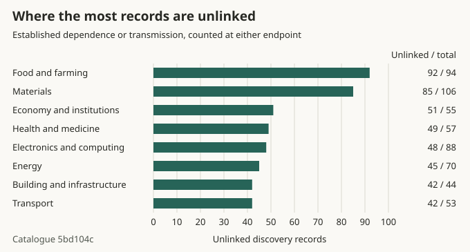

# Where the tech tree needs connections

At dataset commit `5bd104ce465da472e9a811b69d2c6d9d47613a80`, 661 of 902 discoveries (73.3%) have no established dependence or transmission link at either end. A reader starting from 751 records (83.3%) has no incoming link of either kind to follow. Of the 241 records with such links, the largest connected group contains 49, even when the reader can travel in either direction. The other 192 are spread across 68 smaller groups.



## Where coverage breaks down

- **Time.** All 90 discoveries anchored before 3000 BCE lack an established dependence or transmission link. Another 83 of 93 from 3000 BCE through 500 CE lack one. Dating uses the latest bound of the earliest recorded event. Modern history also has substantial gaps in absolute numbers, including 211 of 310 records from 1801 through 1950.
- **Activities.** Food and farming has 92 unlinked records out of 94, materials 85 of 106, economy and institutions 51 of 55, and health and medicine 49 of 57. All 23 arts records lack a link of either kind. Building and infrastructure has no incoming link of either kind across all 44 records, although two have outgoing links.
- **Geography.** By share, South America has 28 of 30 unlinked, Asia 173 of 191 and Africa 61 of 68. By absolute count, Europe has the largest regional backlog, 176 of 297. Regions overlap when records name places on more than one continent. Another 119 records lack a region at the discovery level.
- **Transmission and context.** The catalogue has 167 established dependence links and 17 established transmission links. Across all 237 stored links, only one specifies a carrier and five specify what was contributed in the structured fields. Free text can contain further detail. Only four discovery records explicitly list a missing prerequisite. Only 76 have a sourced or reviewed `prompted_by` facet and 11 have sourced or reviewed funding. These are counts of recorded evidence, with no expectation that every facet applies to every discovery.

## Research order

Start with two pairs of existing records in the least connected era, then examine production, distribution and an abandoned farming landscape. The ordering weighs the number of gaps a case addresses, whether a particular object or event can be identified, and what would settle the question. These are research proposals. The quantitative audit measures only accepted graph relationships.

1. **Recurrent fire use and inferred fish cooking at Gesher Benot Ya’aqov.** Compare the two existing records against Area B, Layer II-6, levels 1–7. The fire study maps burnt flint, and the fish study examines spatial association and heat alteration of teeth. Check that the record events refer to the same deposits and whether the evidence supports a local `uses_process` link with the cooking interpretation explicitly attributed. The teams and assemblages overlap. Independent assessment of the inference matters more than the number of papers. [Fire record](../../../data/discoveries/energy/gesher-recurrent-fire-use.json) · [Cooking record](../../../data/discoveries/food/gesher-fish-cooking-inference.json) · [Fire distribution study](https://www.sciencedirect.com/science/article/pii/S0277379108001480) · [Fish study](https://www.nature.com/articles/s41559-022-01910-z)
2. **Gravity canals and later farming at Ñanchoc, Peru.** The catalogue has both the upper Zaña canals and a much earlier Ñanchoc crop record. The excavators associate Canals 2 and 3 with the Tierra Blanca phase. Look for a dated event on terrace cultivation during that phase, check the canal-to-plot evidence, and identify which crops can actually be tied to those plots. The earlier evidence from teeth documents consumption before the confirmed canals. A link to that earlier event would reverse the chronology. The papers share investigators, so trace any corroboration to its observations. [Canal record](../../../data/discoveries/food/gravity-canals-upper-zana-valley-northern-peru.json) · [Crop record](../../../data/discoveries/food/nanchoc-early-crop-system.json) · [Canal excavations](https://pubmed.ncbi.nlm.nih.gov/16284247/) · [Crop and phase evidence](https://pmc.ncbi.nlm.nih.gov/articles/PMC2604935/)
3. **VHS recording and editing in Yoruba commercial filmmaking.** The 1989 production of *Aje Ni Iya Mi* gives the research a named film, collaborators and a specific equipment question. Misodi traces the VHS camera and two-recorder editing account to Haynes. Seek a crew interview, production document or identifiable equipment from that film. Compare the local practice with the scope of the existing JVC HR-3300 record. A format-level finding can support a local production event while the recorder model remains unknown. Investigate cassette trading separately to establish how copies reached audiences. [Film record](../../../data/discoveries/arts/1989-nigerian-yoruba-commercial-video-films.json) · [Recorder record](../../../data/discoveries/communication/jvc-hr3300-vhs-home-video-recorder.json) · [Misodi, pp. 34–35](https://research.uca.ac.uk/6803/1/Final%20PHd%20Thesis%20in%20PDF.pdf)
4. **Sediment trapping and field construction at Engaruka, Tanzania.** The existing record already describes the check dams. Sections 4 and 11 distinguish wall construction, sediment accumulation and changes in water management. Trace one excavated field sequence and check whether a new, independently describable construction process would add information. A dated or sequenced extension to the existing record may be enough. The cause of abandonment is a separate question. [Engaruka record](../../../data/discoveries/food/engaruka-terraced-irrigation-and-sediment-capture.json) · [Lang and Stump, field sections and discussion](https://www.cambridge.org/core/journals/quaternary-research/article/geoarchaeological-evidence-for-the-construction-irrigation-cultivation-and-resilience-of-15th18th-century-ad-terraced-landscape-at-engaruka-tanzania/05DBDE9BE807417CB5A0FD6A564943EA)
5. **Good’s method and the Cooley–Tukey fast Fourier transform.** This is the first of the seven existing candidate links I would revisit. Page 297 of the 1965 paper discusses Good. The authors’ 1993 recollection describes the development of the radix-2 algorithm and a later inquiry into prior work. Look for dated correspondence, drafts or independent testimony establishing when Good’s work entered the development. A resolution that narrows the claim to acknowledged prior work is valuable. [Candidate record](../../../data/discoveries/electronics/cooley-tukey-fast-fourier-transform-1965.json) · [1965 paper](https://home.cis.rit.edu/~cnspci/references/cooley1965.pdf) · [Authors’ 1993 account](https://garfield.library.upenn.edu/classics1993/A1993MJ84400001.pdf)

## Reproduction

From the repository root, run the following with Python 3.11.4 or later.

```sh
python3 tools/tech_tree_gaps.py 5bd104c docs/analysis/2026-11-17-tech-tree-gaps
```

[Coverage counts](coverage.json) include every primary domain, era and region. Each discovery counts once per primary domain and once per era. An incoming link is stored on the receiving record. Its historical meaning follows its type, which includes component relationships. Component sizes ignore direction. Shared concepts, affinity, parallel achievement and unresolved links are excluded from these lineage counts. Including all established relationship types leaves 637 records with no link. Uneven research and the choice of what merits its own record affect every comparison.
