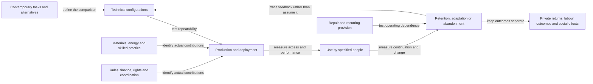

# A chronological and global map of technology in use

Working map, 5 November 2026. This is an index into bounded cases, not an exhaustive sequence of civilisations or a set of invention priorities. The periods below are navigation aids; they do not assign all regions to the same developmental stages. Many practices span several rows, and the collection's modern observations end at different dates.

## Chronological routes through the evidence

| Broad interval | Systems and places in the first edition | What to examine | Case routes |
|---|---|---|---|
| Late Pleistocene and early Holocene | Fired containers among East Asian foragers | Contextual dating, use residues, preservation and the absence of a universal farming prerequisite | [MAT-C01](../cases/MAT-C01.md) |
| Bronze Age and first millennium BCE | Dholavira water storage; Canaan metal transitions; Chinese iron routes; Arabian water galleries; Andean raised fields | Multiple production routes, environmental fit, tasks and uncertainty about origin/transmission | [ANC-C06](../cases/ANC-C06.md), [MAT-C02](../cases/MAT-C02.md), [MAT-C03](../cases/MAT-C03.md), [ANC-C04](../cases/ANC-C04.md), [AGR-C01](../cases/AGR-C01.md) |
| Classical and early imperial periods | Roman hydraulic services, machinery and freight; Han maintenance evidence; Meroe iron production | Technical description versus operating installation, organised upkeep, coercion, complete journeys | [ANC-C01](../cases/ANC-C01.md)–[ANC-C03](../cases/ANC-C03.md), [ANC-C05](../cases/ANC-C05.md), [MOB-C01](../cases/MOB-C01.md), [MAT-C04](../cases/MAT-C04.md) |
| First and second millennia CE before European industrialisation | Chinese and Korean printing; paper networks; Song–Yuan fuel changes; West Mexican metals; Ile-Ife glass; Andean alloys and Inka roads | Selective transfer, locally different purposes, production knowledge, imported materials and persistent alternatives | [NET-C01](../cases/NET-C01.md)–[NET-C03](../cases/NET-C03.md), [MAT-C03](../cases/MAT-C03.md), [MAT-C05](../cases/MAT-C05.md)–[MAT-C07](../cases/MAT-C07.md), [MOB-C02](../cases/MOB-C02.md) |
| Fifteenth–eighteenth centuries | European printing enterprises; Ottoman permissions/customers; Indian Ocean pilot knowledge; early mine pumping; variolation networks | Finance, distribution, legitimacy, skilled people, contemporary alternatives and uncertain transmission | [NET-C04](../cases/NET-C04.md)–[NET-C06](../cases/NET-C06.md), [IND-C01](../cases/IND-C01.md), [MED-C01](../cases/MED-C01.md) |
| Eighteenth–nineteenth centuries | Cornish engines, British water/steam and spinning; India–Lancashire competition; regional textile choices; Ottoman vaccination; antisepsis; colonial Indian rail | Competing price, engineering and political explanations; changing institutions; different choosers and workers | [IND-C02](../cases/IND-C02.md)–[IND-C06](../cases/IND-C06.md), [MED-C02](../cases/MED-C02.md)–[MED-C03](../cases/MED-C03.md), [MOB-C03](../cases/MOB-C03.md) |
| Late nineteenth–mid-twentieth centuries | Hybrid Chinese textiles; US factory motors and household appliances; telephone switching; water/sewerage; early electric vehicles; Ghanaian rail; penicillin supply | Hybridisation, replacement cycles, recurring provision, occupational transitions and unequal outcomes | [IND-C07](../cases/IND-C07.md)–[IND-C08](../cases/IND-C08.md), [AGR-C08](../cases/AGR-C08.md), [LBR-C01](../cases/LBR-C01.md), [MED-C04](../cases/MED-C04.md)–[MED-C05](../cases/MED-C05.md), [MOB-C04](../cases/MOB-C04.md)–[MOB-C05](../cases/MOB-C05.md) |
| Mid-twentieth century–2024 observations | Containers/Singapore; crop varieties and irrigation programmes; tenure/risk interventions; cooking trials; malaria/ORT/prescribing; digital access, mobile money and VR | Standards, distribution, measured behaviour, sustained use, ecological costs, contemporary alternatives and causal tests | [MOB-C06](../cases/MOB-C06.md)–[MOB-C07](../cases/MOB-C07.md), [AGR-C02](../cases/AGR-C02.md)–[AGR-C07](../cases/AGR-C07.md), [MED-C06](../cases/MED-C06.md)–[MED-C08](../cases/MED-C08.md), [DIG case dossier](../contributions/DIG/report.md), [LBR-C02](../cases/LBR-C02.md) |

## Geography is part of the explanation

| Region/connection | Substantial first-wave cases | Important limitation |
|---|---|---|
| East Asia | China/Japan pottery, Chinese iron/fuel, Chinese/Korean printing, Japanese/Indian spinning choices, Chinese textile households and prescribing | Many histories are accessed through English-language scholarship; no claim of region-wide adoption uniformity |
| South Asia | Dholavira, Indian Ocean networks, cotton competition, rail, crop/water systems, cooking, digital education access, Sri Lankan malaria | Country or civilisation labels conceal district, task, class and institutional differences |
| Southeast Asia | Bali irrigation coordination; Singapore port planning | Few cases; official Singapore rationale does not supply affected residents' or workers' outcomes |
| West Asia and North Africa | Canaan metals, Arabian/Iranian galleries, paper transmission, Ottoman print and vaccination | Sparse direct ordinary-user evidence; qanat origins and institutional narratives remain disputed |
| Sub-Saharan Africa and the Nile region | Meroe smelting, Ile-Ife glass, Gambia rice, distinct Ghanaian tenure/risk/rail cases, Kenyan mobile money | Shared national labels are not matched environments; health and industrial histories remain thin |
| Americas | Andean metal/raised fields/Inka road; West Mexican metal; US industry, sanitation, appliances, vehicles, computing and work | US data density dominates some quantitative comparisons; West Mexican material is access-limited |
| Europe and transregional systems | Roman engineering, European print, Britain and connected textile markets, surgery, container standards | Institutional power and overseas inputs belong within these connected histories |
| Oceania and Indigenous systems | Dedicated expansion underway | Not yet represented adequately in this first-wave map; planned additions are not current evidence |

The first-wave sample is weighted toward inspectable scholarly debates and interventions. It is not weighted by population, economic importance, longevity or the number of technologies actually used in each place.

## A branching map, with explicit relation types

The machine-readable [graph](../data/graph.json) contains local technology configurations, complements, resources, institutions and practices. Its [edge inventory](../data/GRAPH_GUIDE.md) links each relationship to cases, claims and sources. The graph is a collection of scoped networks; it intentionally retains disconnected components where this research has not established a connecting history.

The following diagram is an **analytical reading guide**, not an evidence-bearing genealogy. Each arrow names a question to investigate; it does not assert that all systems follow the same sequence or require every box.

Important distinctions in the evidence-bearing graph:

- **Technical possibility:** a reconstruction or principle could support an application under stated conditions.
- **Observed contribution:** a named input or arrangement participated in the historical operation.
- **Documented/inferred transmission:** knowledge or equipment moved through an evidenced or explicitly hypothesised path.
- **Bounded necessity:** a specific configuration required something under stated conditions, with a counterfactual rationale and alternatives.
- **Hypothesis:** a relationship remains to be tested.

`depends-on` points from a system to its requirement; `enables` points from a contributor to the system it supports. Similar-looking nodes are not merged across centuries or places. Multiple incoming edges do not automatically mean joint necessity, and there is no valid automatic transitive inference across different episode scopes. A chronology can be mapped without inventing a causal arrow.
