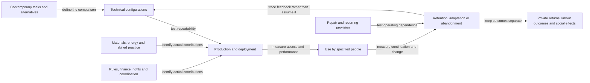

# A chronological and global map of technology in use

Revised edition, 5 November 2026. This map covers every included case through overlapping dated routes. It does not assign all regions to common stages or claim invention priorities. A case may contain ancient operation, a modern reconstruction and a contemporary revival: their dates and evidence remain separate in the case record.

The [complete chronological index](../data/CHRONOLOGICAL_ROUTES.md) gives each case's exact qualified period. The [interactive explorer](../index.html) offers the same routes alongside cases, comparisons and scoped graph relations. Chronological proximity is not evidence of transmission.

## Chronological routes

| Route | Scope | Included cases |
|---|---|---|
| Early fired materials | Late Pleistocene/early Holocene archaeological occurrences and later use evidence; dates are not universal origin claims. | [MAT-C01](../cases/MAT-C01.md) |
| Early cultivation, water and metal systems | Dated archaeological and textual episodes before or spanning the first millennium BCE. Modern rehabilitation/replica observations in these cases are separate. | [ANC-C06](../cases/ANC-C06.md), [ANC-C04](../cases/ANC-C04.md), [MAT-C02](../cases/MAT-C02.md), [MAT-C03](../cases/MAT-C03.md), [MAT-C04](../cases/MAT-C04.md), [AGR-C01](../cases/AGR-C01.md), [OCE-C02](../cases/OCE-C02.md), [OCE-C04](../cases/OCE-C04.md) |
| Classical and early imperial operation | Roman-period systems and ancient Chinese maintenance evidence; uncertain authorial dates and separate later emergencies remain explicit. | [ANC-C01](../cases/ANC-C01.md), [ANC-C02](../cases/ANC-C02.md), [ANC-C03](../cases/ANC-C03.md), [ANC-C05](../cases/ANC-C05.md), [MOB-C01](../cases/MOB-C01.md) |
| First and second millennia: materials, exchange and cultivation | Broadly pre-1500 routes, often with earlier roots or later subepisodes. The row does not assign regions to one developmental stage. | [MAT-C03](../cases/MAT-C03.md), [MAT-C05](../cases/MAT-C05.md), [MAT-C06](../cases/MAT-C06.md), [MAT-C07](../cases/MAT-C07.md), [NET-C01](../cases/NET-C01.md), [NET-C02](../cases/NET-C02.md), [NET-C03](../cases/NET-C03.md), [POL-C02](../cases/POL-C02.md), [MOB-C02](../cases/MOB-C02.md), [NET-C06](../cases/NET-C06.md), [OCE-C05](../cases/OCE-C05.md) |
| Fifteenth to eighteenth centuries: craft, institutions and transmission | Overlapping histories of publishing, navigation, mine power, firearms, variolation and precision work. Observation dates are retained per case. | [NET-C04](../cases/NET-C04.md), [NET-C05](../cases/NET-C05.md), [NET-C06](../cases/NET-C06.md), [IND-C01](../cases/IND-C01.md), [MED-C01](../cases/MED-C01.md), [POL-C01](../cases/POL-C01.md), [SKL-C01](../cases/SKL-C01.md), [IND-C02](../cases/IND-C02.md), [IND-C05](../cases/IND-C05.md) |
| Eighteenth and nineteenth centuries: production and public systems | Task-specific industrial changes, competing production routes, metrication, precision and colonial infrastructure. No general industrial-stage chronology is implied. | [IND-C02](../cases/IND-C02.md), [IND-C03](../cases/IND-C03.md), [IND-C04](../cases/IND-C04.md), [IND-C05](../cases/IND-C05.md), [IND-C06](../cases/IND-C06.md), [SKL-C01](../cases/SKL-C01.md), [SKL-C02](../cases/SKL-C02.md), [SKL-C03](../cases/SKL-C03.md), [POL-C04](../cases/POL-C04.md), [MED-C02](../cases/MED-C02.md), [MED-C03](../cases/MED-C03.md), [MOB-C03](../cases/MOB-C03.md) |
| Late nineteenth to mid-twentieth centuries: networks and contested work | Urban infrastructure, electrification, textiles, transport and labour. Later persistence and retrospective interviews are separated from the original operating intervals. | [IND-C06](../cases/IND-C06.md), [IND-C07](../cases/IND-C07.md), [IND-C08](../cases/IND-C08.md), [POL-C03](../cases/POL-C03.md), [MED-C04](../cases/MED-C04.md), [MED-C05](../cases/MED-C05.md), [MOB-C04](../cases/MOB-C04.md), [MOB-C05](../cases/MOB-C05.md), [LBR-C01](../cases/LBR-C01.md), [AGR-C08](../cases/AGR-C08.md), [GHA-C01](../cases/GHA-C01.md), [GHA-C02](../cases/GHA-C02.md), [GHA-C03](../cases/GHA-C03.md) |
| Mid to late twentieth century: manufacturing, public programmes and renewal | Many cases continue into the twenty-first century. Manufacture, adoption, historical reconstruction and later study dates are different observations. | [CTX-C01](../cases/CTX-C01.md), [ENE-C01](../cases/ENE-C01.md), [ENE-C02](../cases/ENE-C02.md), [ENE-C03](../cases/ENE-C03.md), [ENE-C04](../cases/ENE-C04.md), [ENE-C05](../cases/ENE-C05.md), [MOB-C06](../cases/MOB-C06.md), [MOB-C07](../cases/MOB-C07.md), [MED-C06](../cases/MED-C06.md), [MED-C07](../cases/MED-C07.md), [AGR-C01](../cases/AGR-C01.md), [AGR-C02](../cases/AGR-C02.md), [AGR-C03](../cases/AGR-C03.md), [AGR-C04](../cases/AGR-C04.md), [AGR-C05](../cases/AGR-C05.md), [AGR-C08](../cases/AGR-C08.md), [DIG-C01](../cases/DIG-C01.md), [DIG-C02](../cases/DIG-C02.md), [LBR-C02](../cases/LBR-C02.md), [SKL-C04](../cases/SKL-C04.md), [SKL-C05](../cases/SKL-C05.md), [SKL-C06](../cases/SKL-C06.md), [OCE-C01](../cases/OCE-C01.md), [OCE-C02](../cases/OCE-C02.md) |
| Twenty-first-century use, trials and knowledge recovery | Dated studies and contemporary subepisodes, not a claim that the techniques originated then. Archaeological/experimental comparators stay distinct; final-abstract and manuscript boundaries remain. | [AGR-C04](../cases/AGR-C04.md), [AGR-C06](../cases/AGR-C06.md), [AGR-C07](../cases/AGR-C07.md), [MED-C06](../cases/MED-C06.md), [MED-C08](../cases/MED-C08.md), [DIG-C02](../cases/DIG-C02.md), [DIG-C03](../cases/DIG-C03.md), [DIG-C04](../cases/DIG-C04.md), [DIG-C05](../cases/DIG-C05.md), [DIG-C06](../cases/DIG-C06.md), [DIG-C07](../cases/DIG-C07.md), [ENE-C01](../cases/ENE-C01.md), [ENE-C02](../cases/ENE-C02.md), [ENE-C04](../cases/ENE-C04.md), [ENE-C05](../cases/ENE-C05.md), [OCE-C01](../cases/OCE-C01.md), [OCE-C02](../cases/OCE-C02.md), [OCE-C03](../cases/OCE-C03.md), [OCE-C05](../cases/OCE-C05.md), [PSY-C01](../cases/PSY-C01.md), [PSY-C02](../cases/PSY-C02.md), [PSY-C03](../cases/PSY-C03.md), [PSY-C04](../cases/PSY-C04.md), [PSY-C05](../cases/PSY-C05.md), [SKL-C05](../cases/SKL-C05.md), [LBR-C02](../cases/LBR-C02.md) |

## Geography, connections and uneven observation

| Region/connection | Included investigations | Remaining limitation |
|---|---|---|
| East Asia | Pottery/iron, Chinese/Korean books, textiles across distinct regimes, Tokugawa guns, Yuan currency, Qing telegraph, clocks, manufacturing and prescribing | English-language mediation is substantial; local observations are not national rates; post-1949 textile evidence is a retrospective village sample |
| South Asia | Dholavira, Indian Ocean navigation, cotton competition, rail, varieties/groundwater, cooking, schooling access, digital education and Sri Lankan malaria | District, class, gender and institutional differences limit country-level transfer; household exclusion and unpaid work are unevenly measured |
| Southeast Asia | Bali coordination, Indonesian seaweed learning, Singapore terminals | Few focal settings; official infrastructure accounts do not provide complete nonchooser outcomes |
| West Asia / Islamic Mediterranean | Levant metals, falaj/qanat contrasts, paper, Ottoman printing and vaccination | Origin/transmission claims and local enforcement remain uneven; direct user evidence is sparse |
| Sub-Saharan Africa and Nile region | Meroe, Ile-Ife, Gambia irrigation, distinct Ghanaian land/risk/rail/road cases, Kenya money/fertilizer, Malawi communication, Zambia bicycles, Tanzanian repair | Cases share places or scholarship without being matched comparisons; historical access to work and future livelihoods remain incompletely observed |
| Americas | Andean metals/fields/roads, West Mexican metal, US production, infrastructure, household work, labour studies, digital use and manufacturing | US quantitative evidence is disproportionately dense; some archaeological interpretations remain access-limited |
| Oceania and Indigenous networks | Hōkūleʻa inter-island learning, Gunditjmara water authority, Martu fire and governance, Kuk drainage, Māori kūmara adaptation/recovery | Contemporary practices are not unchanged precolonial replicas; local testimony, archaeology and experimental feasibility establish different things; catch/yield/adoption and long-term welfare often unmeasured |
| Europe and connected systems | Roman services, publishing, British/Indian industrial relations, precision/navigation, metrication, medical practice, ports and energy | European histories are connected to overseas inputs and power; they are not the default counterfactual for every region |

These are coverage descriptions, not area-weighted adequacy scores. Broad archaeological intervals, a named village and a multi-country trial do not provide equal geographical coverage. The [selection register](SELECTION_REGISTER.md) explains additions made because of review, and the [uncertainty register](UNCERTAINTY_AND_NEXT_RESEARCH.md) records remaining languages, domains and populations.

## A branching map, with explicit relation types

The machine-readable [graph](../data/graph.json) contains local technology configurations, complements, resources, institutions and practices. Its [edge inventory](../data/GRAPH_GUIDE.md) links each relationship to cases, claims and sources. The graph is a collection of scoped networks; it intentionally retains disconnected components where this research has not established a connecting history.

The following diagram is an **analytical reading guide**, not an evidence-bearing genealogy. Each arrow names a question to investigate; it does not assert that all systems follow the same sequence or require every box.

Important distinctions in the evidence-bearing graph:

- **Technical possibility:** a reconstruction or principle could support an application under stated conditions.
- **Observed contribution:** a named input or arrangement participated in the historical operation.
- **Documented/inferred transmission:** knowledge or equipment moved through an evidenced or explicitly hypothesised path.
- **Bounded necessity:** a specific configuration required something under stated conditions, with a counterfactual rationale and alternatives.
- **Hypothesis:** a relationship remains to be tested.

`depends-on` points from a system to its requirement; `enables` points from a contributor to the system it supports. Similar-looking nodes are not merged across centuries or places. Multiple incoming edges do not automatically mean joint necessity, and there is no valid automatic transitive inference across different episode scopes. A chronology can be mapped without inventing a causal arrow.
