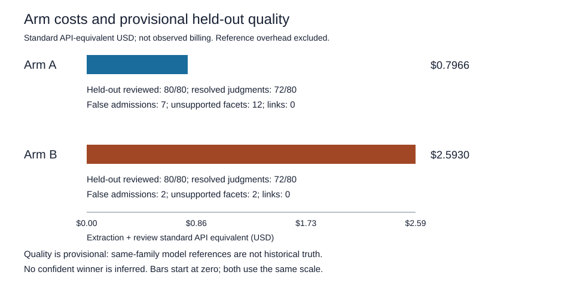

# Neither tested workflow met the quality gate

Retain **Terra low extraction + Sol medium semantic review (Arm B)** as a conservative interim route, with selective escalation and no automatic admission. No new large campaign was started.

On the 80 held-out cases, the primary blinded source assessment flagged 7 admission proposals in A and 2 in B. Final mechanical checks failed 5 reviewed outputs in A and 0 in B. Both arms therefore failed the declared gate. These are model-reference judgments and protocol failures, not certified historical error rates. The targeted secondary reading disagreed on five claim labels; see [adjudication process and sensitivity](adjudication.json).

Across all 100 candidates, extraction/review cost was **$0.797 for A** and **$2.593 for B**, a standard API-equivalent scenario excluding evaluation overhead. B cost 3.26 times as much. Source/referee overhead must remain visible: the primary CLI run totals $24.354; targeted secondary review adds $0.146, for $24.500 combined observed model equivalent. This is not observed billing or subscription-credit usage.

The primary metrics below preserve one consistent full-set assessment. Secondary model disagreement is reported separately rather than resolved by majority vote. A 100-case set, same-family references and no independent historian/human reference cannot establish a sub-1% error rate or a confident passing winner.

## Accounting

The standard API-equivalent estimate is $24.353674; the doubled cache-write-rate sensitivity is $24.353674. These are pricing scenarios, not an invoice, subscription-credit measurement or observed billing.

| Arm / split / stage | Calls | Input | Cache reads | Cache writes | Output incl. reasoning | Reasoning subset | Estimated USD |
| --- | ---: | ---: | ---: | ---: | ---: | ---: | ---: |
| A / calibration / extract | 20 | 170421 | 35840 | 0 | 6011 | 0 | 0.016822 |
| A / calibration / review | 20 | 176843 | 56320 | 0 | 10306 | 2583 | 0.174869 |
| A / held_out / extract | 80 | 698405 | 271360 | 0 | 24455 | 0 | 0.057646 |
| A / held_out / review | 80 | 724476 | 373760 | 0 | 35564 | 6883 | 0.547224 |
| B / calibration / extract | 20 | 170339 | 61440 | 0 | 6455 | 0 | 0.144246 |
| B / calibration / review | 20 | 177171 | 0 | 0 | 11706 | 3775 | 0.471402 |
| B / held_out / extract | 80 | 698487 | 363520 | 0 | 25206 | 0 | 0.479173 |
| B / held_out / review | 80 | 725119 | 194560 | 0 | 41758 | 11518 | 1.498154 |
| overhead / calibration / reference | 20 | 170299 | 30720 | 0 | 9776 | 2178 | 1.915310 |
| overhead / held_out / reference | 80 | 698245 | 261120 | 0 | 37679 | 7194 | 6.516320 |
| overhead / overhead / adjudication | 101 | 1051733 | 245760 | 0 | 61699 | 8248 | 11.390440 |
| overhead / overhead / proposal | 6 | 104722 | 15360 | 0 | 8728 | 1262 | 1.142068 |

Global response-ID deduplication retained 607 responses and excluded 0 repeated IDs. Uncached input is 3656500 tokens. Reasoning is already inside output and is never added again.

Aggregate request duration is 9266.53 seconds; observed wall span is 3273.38 seconds. Their difference reflects overlap and gaps; it is not a causal efficiency estimate. Inflight requests have incomplete durations.

## Held-out quality

Reference standard: `model_only`. All reference and adjudication models are from the same family. Source-based model judgments, including selective dispute review, remain provisional and correlated; agreement is not historical truth.

| Arm | Judged / 80 | Resolved | Ref. admissions | False admits | False rejects | Unsupported facets / links | Provisional gate |
| --- | ---: | ---: | ---: | ---: | ---: | --- | --- |
| A | 80 | 72 | 62 | 7 | 0 | 12 / 0 | False |
| B | 80 | 72 | 62 | 2 | 1 | 2 / 0 | False |

The preregistered held-out gates require zero false admissions, zero unsupported facets/links and at most 5% false rejects among resolved reference admissions. Unresolved references are excluded from the false-reject denominator and reported separately. Unsupported or unresolved admitted claims still fail the gate even when reference priority is unresolved. Complete judgment coverage requires all 80 cases judged, including correct source deferrals; it does not require all reference histories resolved. Missing quality checks remain unavailable and prevent a provisional pass. Calibration cases do not count toward held-out gate outcomes.

| Arm | Useful reviewed records | Supported claims | USD / useful record | USD / supported claim |
| --- | ---: | ---: | ---: | ---: |
| A | 54 | 119 | 0.011201288888888892 | 0.005082937815126052 |
| B | 59 | 132 | 0.03351401694915254 | 0.014979749999999998 |
Arm A: source-judged useful records 55, mechanically blocked useful records 1, raw source-supported claims 123, mechanically usable supported claims 119.
Arm A: 8 unresolved reference cases, 0 judged cases with missing quality checks, and 0 unresolved admitted claims.
Arm B: source-judged useful records 59, mechanically blocked useful records 0, raw source-supported claims 132, mechanically usable supported claims 132.
Arm B: 8 unresolved reference cases, 0 judged cases with missing quality checks, and 0 unresolved admitted claims.

These unit costs allocate held-out extraction/review cost only. Reference, adjudication and proposal-generation overhead is reported separately in the accounting table. Useful-record and supported-claim counts inherit the provisional reference limitation and require the original mechanical validation gate. Mechanical quote-length/presence, schema and date failures are formal validation failures; source-based false-admission/reject judgments remain unchanged.

## Reproduction and limits

Source commit: `f5a5c352cf07475397726a635ddb04d69807bcd6`. Fixture SHA256: `3097690a3e143a6cec84579e996be328d59ac95d395eaeb8879510656d7ee30a`. `analysis.json` contains input artifact hashes; raw prompts, conversations, original source context, quotations and stderr remain private. Public structured answers replace quotations with SHA256 hashes. `calls.csv` provides safe per-call accounting.

Reproduce with `python3 tools/cards/analyze_comparison.py --state /absolute/private/comparison --judgments /absolute/private/comparison/judgments.json`. Omit `--judgments` only to report unavailable quality. The script reads existing calls and never dispatches models.

No strict 25,000 reasoning-token cap is available from the documented CLI. Finite guards are checked between calls and up to four inflight requests may overshoot. Provider-reported tool/search usage, observed billing and subscription-credit accounting remain unavailable. Proposal-generation outputs are separate from the fixed admission set.

Mechanical review validation (original frozen rule; categories may overlap):

A / all: 95 passed, 5 failed, 0 unavailable; failed admission proposals 3; categories {'quote_length': 3, 'quote_presence': 2, 'schema': 0, 'date': 0}.
A / calibration: 20 passed, 0 failed, 0 unavailable; failed admission proposals 0; categories {'quote_length': 0, 'quote_presence': 0, 'schema': 0, 'date': 0}.
A / held_out: 75 passed, 5 failed, 0 unavailable; failed admission proposals 3; categories {'quote_length': 3, 'quote_presence': 2, 'schema': 0, 'date': 0}.
B / all: 100 passed, 0 failed, 0 unavailable; failed admission proposals 0; categories {'quote_length': 0, 'quote_presence': 0, 'schema': 0, 'date': 0}.
B / calibration: 20 passed, 0 failed, 0 unavailable; failed admission proposals 0; categories {'quote_length': 0, 'quote_presence': 0, 'schema': 0, 'date': 0}.
B / held_out: 80 passed, 0 failed, 0 unavailable; failed admission proposals 0; categories {'quote_length': 0, 'quote_presence': 0, 'schema': 0, 'date': 0}.
0 call artifacts have no response usage. Token/cost sums cover observed response records only; missing accounting is not an observed zero.

Observed tool calls: 0; 0 calls have unknown tool observation coverage. Counts use raw saved observations or an audit bound to the exact raw file SHA256 and fingerprint; unknown is not an observed zero. Provider-reported tool/search usage and billing remain unavailable.

## Proposal comparison

The three generators received the same 886-record inventory plus 213 pending titles, at most 12 proposals, the same 1800-token answer target and 150-second timeout, with no web tools. The CLI could not enforce equal reasoning-token ceilings or equal realized spend. All three produced 12 text-judged useful hypotheses; historical accuracy and source-verified novelty remain unmeasured. No suggestion entered the 100-case set or dataset.

| Model / effort | Hypotheses | Text useful | Generation API-equivalent USD | Seconds |
| --- | ---: | ---: | ---: | ---: |
| gpt-6.1-sol / medium | 12 | 12 | 0.05083 | 62.8 |
| gpt-6-astra / low | 12 | 12 | 0.20369 | 78.8 |
| gpt-6-astra / medium | 12 | 12 | 0.25782 | 80.5 |

Use Sol medium for initial proposals on observed cost. This does not establish equal historical knowledge or rule out value from targeted Astra critique. [Proposal measurements](proposal-summary.json) separate text quality from source verification.

## Reference sensitivity

The initial Astra-medium source reading and fresh Astra-low reference decision differed on one of the 100 cases. A targeted blinded Sol-medium reading of five cases differed on five claim labels. Those cases were selected for disputes, not randomly: no disagreement rate or historical error estimate follows. The consistent full-set primary assessment remains visible alongside the secondary reading; no label was promoted to truth by model agreement. Some disagreements concern the conservative corroboration rule rather than literal passage entailment. See [adjudication details](adjudication.json).

## Interpretation and preserved work

“Unsupported links” in the table counts explicit link-facet records. No such link claims were retained. Relational assertions embedded in achievement statements were still assessed: Arm A: 1 unsupported relation assertion(s), Arm B: 1 unsupported relation assertion(s). Zero explicit links is not evidence of validated transmission precision.

The comparison reused 113 frozen saved source pages across 90 cases; ten retained source failures stayed missing. Historical retrieval/search was not repeated, so these costs do not estimate a full search campaign. All 92 original working files were privately archived and remain separate from implementation. The 213-candidate resume queue adopted 181 retained acquisition/extraction pairs, with 32 incomplete source sets explicitly deferred. No legacy review became current semantic admission. The committed baseline plus exact task changes is validated separately from the preserved live tree’s 33 unfinished-reference errors.

The source sample is predominantly English; translated/non-Latin normalization and global language coverage were not validated. One source-ID copying failure and three overlength quotations show sensitivity to the benchmark representation/bounds; these are distinguished from historical support failures. The production card compiler uses integer source references.

Public outputs contain structured answers, quotation hashes, scalar/claim labels and provenance; full source pages, prompts and raw conversations remain private. Exact model/effort, prompt/evidence versions, response IDs and parameters are retained in the private call artifacts. See [execution constraints](execution.json), [selected interim policy](decision.json), [auxiliary review accounting](auxiliary-usage.json) and [official OpenAI pricing](https://developers.openai.com/api/docs/pricing).
