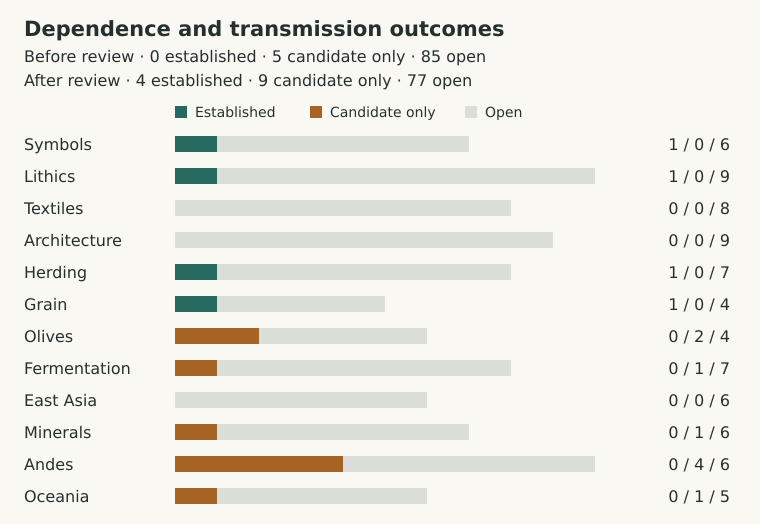

# Prehistory research wave

4 of 90 previously isolated discoveries gained an established dependence or transmission relationship. After review, 9 had a candidate as their strongest relationship in those layers and 77 remained open. The wave added or promoted 4 distinct directed relationships in those layers and 3 relationships in other layers.

[Research priorities](research-priorities.md) · [Evidence reader](view.html) · [Machine-readable results](results.json) · [Frozen frontier](../2026-11-17-all-eras/frontier/research-frontier.csv) · [Roster](roster.json)

## Graph outcomes

The graph gained 14 discovery records and removed 0 records. On existing records, the wave added 16 events, revised 53 events and removed 1 event. The net event change across all reviewed discoveries was +31. The review promoted 0 scoped candidates to established status. 9 relationships newly have candidate status, and 3 assessed candidates retained their status.

| Research lane | Records | Established link | Candidate only | Open | With an insufficient assessment |
| --- | ---: | ---: | ---: | ---: | ---: |
| [Symbols](lanes/symbols.json) | 7 | 1 | 0 | 6 | 0 |
| [Lithics](lanes/lithics.json) | 10 | 1 | 0 | 9 | 0 |
| [Textiles](lanes/textiles.json) | 8 | 0 | 0 | 8 | 0 |
| [Architecture](lanes/architecture.json) | 9 | 0 | 0 | 9 | 0 |
| [Herding](lanes/herds.json) | 8 | 1 | 0 | 7 | 0 |
| [Grain](lanes/grain.json) | 5 | 1 | 0 | 4 | 0 |
| [Olives](lanes/olives.json) | 6 | 0 | 2 | 4 | 0 |
| [Fermentation](lanes/ferment.json) | 8 | 0 | 1 | 7 | 0 |
| [East Asia](lanes/eastasia.json) | 6 | 0 | 0 | 6 | 0 |
| [Minerals](lanes/minerals.json) | 7 | 0 | 1 | 6 | 2 |
| [Andes](lanes/andes.json) | 10 | 0 | 4 | 6 | 0 |
| [Oceania](lanes/oceania.json) | 6 | 0 | 1 | 5 | 0 |

Each anchor counts once under its strongest dependence or transmission status in either direction. Open means there is no established or candidate edge in those layers. Insufficient assessments are listed separately and can overlap any outcome. The evidence reader also shows the researcher's original assessment, which may concern a dated find or an affinity relationship.

## Established relationship changes

| Recorded direction | Type | Layer | Previous status |
| --- | --- | --- | --- |
| Early Egyptian hieroglyphic writing → Proto-Sinaitic alphabetic writing at Serabit el-Khadim (`serabit-alphabetic-inscriptions`) | `adapts` | dependence | absent |
| Split oak timbers for Linear Pottery wells (`altscherbitz-split-oak-beams`) → Altscherbitz timber frame with wedged tenons (`documented-case`) | `companion_of` | affinity | absent |
| Mixed meat and dairy cattle husbandry at Ludwinowo 7 (`ludwinowo-phases-iib-iii-cattle`) → Kuyavia dairy straining (`ludwinowo-phases-iib-iii-sieves`) | `uses_process` | dependence | absent |
| Native copper working at Çayönü Tepesi (`archaeological-evidence-7500bce`) → Gerzeh meteoritic-iron beads (`archaeological-evidence-3100bce`) | `same_principle` | affinity | absent |
| Nonlocal stone procurement at Nyayanga (`nonlocal-cobbles-ny1`) → Oldowan flaked stone tools in East Africa (`archaeological-evidence-2579050bce`) | `uses_process` | dependence | absent |
| Pottery in Neolithic Upper Mesopotamia and the northern Levant → Ruminant dairy use in pottery at Tell Sabi Abyad (`operation-iv-dairy-residue`) | `companion_of` | affinity | absent |
| Early Natufian plant grinding and pounding at Shubayqa 1 (`documented-evidence`) → Shubayqa bread-like food (`documented-evidence`) | `uses_process` | dependence | absent |

## Retained relationships with revised link types

- Gravity canals, upper Zaña valley, northern Peru → Ñanchoc mixed crop food production retained `candidate` status at the same event scope. The review changed the stored type from `uses_process` to `requires`.

## Method

The roster is the `before 3000 BCE` cohort in the frozen frontier at `71326e01a105da21decb1587195a81bd5b596b8c`. The exporter checks one ledger row and one independent Terra High verdict for each roster ID. The cohort retains its frozen membership when review revises a record's date. It applies only the file contents bound by those accepted reviews at `f6005ca2a29db51d9b4ccb67a74e3784f4fa54f9`. It counts distinct directed relationships by sender, receiver and type. The detailed changes also track individual event attachments. The exporter checks every prospective or retained candidate and established ledger decision against the snapshots. The graph excludes candidates, insufficient links, parallel achievements and affinity from its prerequisite and transmission coverage. A missing edge marks a catalogue research gap.
