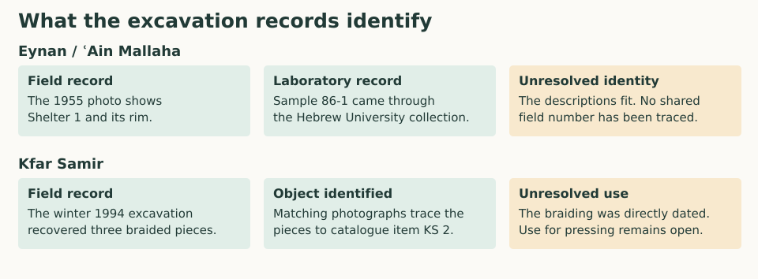

# From excavation finds to operating technologies

Two investigations started with a specimen identifier and followed it back to the field. Eight later investigations started with a particular machine, service, work of art or standard and looked for a record of who actually made, received or used it. The [evidence reader](view.html) opens each observation alongside its source, page or figure and the independent review.



## Eynan sample 86-1

The laboratory paper identifies burnt-lime plaster from a bench-like structure at Eynan. It records sample 86-1 and credits the Hebrew University of Jerusalem collection through Ofer Bar-Yosef. A 1955 field photograph locates Shelter 1 and its plastered perimeter. Dubreuil, quoting Perrot’s 1966 excavation account, observed that the polished, outward-sloping rim probably corresponds to the feature the laboratory sampled. The two descriptions fit. The published laboratory record gives no field number or exact sampling spot. The tree retains the Shelter 1 attribution as a candidate, and the assignment of 86-1 to this Early Natufian context remains unverified. [Laboratory paper, table 1 and pp. 224–226](https://repository.si.edu/server/api/core/bitstreams/90d7b2ae-44bf-4e69-909e-6315a31a861f/content) · [1955 field photograph, fig. 4](https://www.sciencedirect.com/science/article/pii/S2352226725000285) · [Dubreuil, p. 124](https://oskar-bordeaux.fr/bitstream/handle/20.500.12278/25427/DUBREUIL_LAURE_2002.pdf?isAllowed=y&sequence=1)

The next archival test is to match a sample entry in Jean Perrot’s **JP220** catalogue for 1955–1961 with a Hebrew University collection label, loan or laboratory intake record for 86-1. The finding aid identifies the catalogue. Its entries and the full 1957 and 1966 reports were unavailable in this investigation. The feature’s use is a separate open question. [Archive inventory, p. 11](https://archives.mshmondes.cnrs.fr/downloads/jean-perrot-du-village-a-letat-au-proche-et-moyen-orient-diffusion.pdf#page=11) · [Full Eynan trace](lanes/eynan.json)

## Kfar Samir KS 2

The 1997 excavation photograph, the Israel Antiquities Authority’s 2007 field report and the 2023 catalogue reproduce the same underwater scene. The scale board, pebble, frayed basket edge and crossed branches match. The distinctive losses and strands on the three conserved pieces independently match their later photographs. This identifies the 1994 basket as **KS 2**. The 2007 report directly dates its braiding to **5000–4730 calibrated BCE**, laboratory reference **RT 4689**. A later account gives a different range also published for a separate mat. The original assay would show which KS 2 fragment was sampled and how its date was calculated. [1997 field photograph, printed fig. 5](https://figures.academia-assets.com/40144739/figure_006.jpg) · [2007 IAA field report, figs. 3–5](https://hadashot.iaa.org.il/report_detail_eng.aspx?id=552&mag_id=112) · [2023 catalogue, fig. 7 and table 1](https://www.mdpi.com/1999-4907/14/12/2373)

Olive stones lay in the basket pit. The installation containing crushed olives lay several dozen metres south. Pressing, holding and later disposal remain possible explanations. The tree retains the association with oil extraction as a candidate. The next test is to join the IAA field number and conservation record to the RT 4689 submission and look for documented residue or wear on the same pieces. [Field context](https://hadashot.iaa.org.il/Report_Detail.aspx?id=552&mag_id=112) · [Full KS 2 trace](lanes/samir.json)

## Eight workflows tested on later discoveries

| Workflow | What the records establish in the pilot | Next target for the same test |
|---|---|---|
| [Steam engines](lanes/steam.json) | Boulton & Watt’s correspondence and Fulton’s description connect an engine to the New York–Albany boat. A passenger independently documented the September 1807 packet trip. | Henry Bell’s *Comet*, with a surviving engine and advertised Clyde service |
| [Passenger rail](lanes/rail.json) | The Bombay–Thane invitation train ran on 16 April 1853. The Government Director’s report dates opening for traffic to 18 April. A contemporary account gives 17 April. The first ordinary ticket remains untraced. | The Madras–Arcot line and its route-specific traffic returns |
| [Telephone exchanges](lanes/telephony.json) | The February 1878 New Haven directory has 50 printed listings, including 11 under residences. A March 1880 newspaper reports telephone use at the listed Police Office. The launch headcount and the later call’s routing remain open. | Radiolinja’s Finnish GSM launch and evidence of subscriber service |
| [Printmaking](lanes/printing.json) | Edition 69-62 identifies Kenojuak’s *The Arrival of the Sun*. Film records her evaluating a proof. The exact sheet shown remains unidentified. Kinngait stonecuts already existed before the documented Japanese rubbing-tool exchange. | Leah Qumalu’s *Sea Goddess* and the Puvirnituq edition records |
| [Fibre optics](lanes/optics.json) | Bell’s engineers describe twelve-ribbon cable in Atlanta and two-ribbon cable in Chicago, both using twelve-fibre ribbons. Illinois Bell’s full customer-traffic cutover was on 11 May 1977. The nature of the April traffic remains disputed. | General Telephone’s Artesia–Long Beach installation |
| [Mass metrology](lanes/metrology.json) | The 2018 vote, the effective definition on 20 May 2019 and the autumn 2019 NIST-4 measurements of standards 85 and 104 are separately documented. | The 1983 metre definition and a named laser measurement |
| [Offshore wind](lanes/electricity.json) | Procurement, installed equipment, grid connection and settlement records trace East Anglia ONE into service. Elexon records positive delivery by 2 September 2019. The first exporting turbine and interval remain open. | Beatrice Offshore Wind Farm’s export connection |
| [Shipped software](lanes/computing.json) | The Emoji 15.1 horizontal head shake shaped as two glyphs in the older Noto font and one in Debian 12.4’s packaged font. A control without the joiner produced two. | Unicode 15.0 Kawi in a traceable font distribution |

The metrology pilot supports two graph links. The Metre Convention supplied the institutional authority for the 2018 definition. The definition supplied the fixed Planck constant used for the particular NIST-4 mass assignments in 2019. The balance already operated before the vote. In optics, the engineering reports establish the Chicago installation and cutover. Independent evidence tying the installed cable design to the Atlanta trial is still missing, so the proposed adaptation remains a candidate. A contemporary inspection report or a catalogued Chicago cable specimen tied to the installed route would test that connection. [Metrology review](reviews/metrology.json) · [Optics review](reviews/optics.json)

Each pilot includes the inputs needed for another case, searches to run, source locators, evidence that could defeat the proposed connection, and a stopping rule. A blank worksheet keeps these steps and leaves space for new observations.

```sh
python3 tools/provenance.py list
python3 tools/provenance.py start steam --subject "Henry Bell's Comet" > comet-worksheet.md
```

This round added 4 discoveries, 19 dated events and 36 source records. It updated 10 existing discoveries. Of the three new graph links, two are established and one is a candidate. Ten GPT-6.2 Sol High research proposals received independent GPT-6.1 Terra High review before integration. The [review manifest](review-manifest.json) identifies the exact research and review revisions, and each [review receipt](reviews/) lists the checks, limitations and approved file hashes. [Workflow commands and reader regeneration](WORKFLOWS.md)
